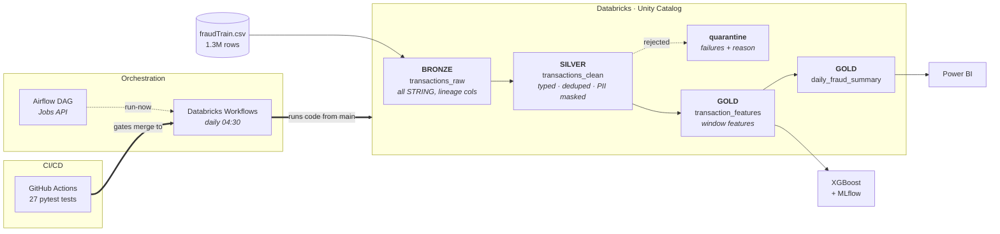

# Banking Fraud Detection Pipeline

An end-to-end data pipeline that ingests 1.3M credit card transactions, cleans and
feature-engineers them through a medallion architecture on Spark, trains a fraud classifier, and
serves a dashboard — **running unattended on a daily schedule, with CI that blocks changes which
break the transform logic.**

The engineering is the point. The model is deliberately simple.



---

## Headline numbers

| | |
|---|---|
| Transactions processed per run | **1,296,675** |
| End-to-end pipeline runtime | **2 m 40 s** (4 chained tasks) |
| Consecutive successful scheduled runs | **6**, spread 2 m 34 s – 2 m 43 s |
| Storage reduction, CSV → Delta | **~80%** (335 MB → 65.6 MB) |
| Unit tests gating every merge | **27** |
| Fraud rate (class imbalance) | **0.58%** — 172 : 1 |
| Model PR-AUC | **0.97** — *see caveat below* |

---

## What it does

**Bronze** lands the raw CSV in Delta with every column as `STRING` and three lineage columns
(`_ingest_ts`, `_source_file`, `_batch_id`). No schema inference — it costs an extra full scan and
is non-deterministic across batches. Casting is deferred to silver where it's explicit and tested.

**Silver** casts types, deduplicates on the natural key, and applies six data-quality rules. Rows
that fail are **quarantined with the reason attached** rather than silently dropped — a dead-letter
queue, so a data-quality problem is visible instead of just making counts shrink.

Silver is also the **PII boundary**. `cc_num` becomes a SHA-256 `card_id` — still a valid grouping
key for window functions, but not a card number. `dob` becomes `customer_age`. Names and street
addresses are dropped entirely. Nothing downstream — gold, the model, the dashboard — ever sees a
direct identifier.

**Gold** builds per-card behavioural features over time windows: rolling 24h and 7d transaction
counts, expanding average spend, time since the card's previous transaction, amount relative to
that card's own average, and haversine distance between the cardholder's address and the merchant.

Every window ends at the current row. **None uses `unboundedFollowing`** — a feature built from
rows that come after the transaction would use information that doesn't exist at scoring time, and
the model's metrics would be fiction.

**Model**: XGBoost with `scale_pos_weight` for the imbalance, split chronologically (train on the
past, predict the future), logged to MLflow.

---

## The parts worth looking at

### CI that provably blocks a bad change

A branch changed the 24-hour window from `rangeBetween(-86400, 0)` to `rowsBetween(-3, 0)` — a
change that reads as a harmless simplification and would plausibly pass code review.

`rowsBetween` counts **rows**; `rangeBetween` counts **values of the ordering column**. Since
`unix_time` is in seconds, only `rangeBetween` gives a genuine 24-hour window.

CI failed on `test_24h_window_is_time_based_not_row_based` with `assert 4 == 1`, and branch
protection blocked the merge.

<!-- TODO: screenshot of the failed check on the PR -->

That test is a trap set for one specific future mistake. It's the most useful thing in this repo.

### A feature that separates the classes on its own

| `amt_vs_card_avg` | Mean |
|---|---|
| Fraudulent transactions | **6.49** |
| Legitimate transactions | **0.968** |

Fraudulent transactions average 6.5× the cardholder's own running average; legitimate ones sit
right at it. That comes from a hand-built window feature, before any model is involved.

### It actually runs

Six consecutive successful runs, four of them scheduled with nobody watching, all within nine
seconds of each other.

<!-- TODO: screenshot of Databricks run history -->

The job sources its notebooks from GitHub `main` rather than from the workspace. Combined with
branch protection, that closes the loop: **code only reaches `main` through a PR with passing
tests, and the scheduled job runs exactly what's on `main`.**

---

## Honest caveats

**PR-AUC of 0.97 is far above what real card-fraud models achieve** (~0.3–0.6). The data is
synthetic — Sparkov generates fraud using explicit rules, which are far more learnable than real
fraud. The pipeline was checked for leakage (every window ends at the current row, the split is
chronological) and the number is real *for this dataset*. It is not a claim about real-world fraud
detection.

**Accuracy is deliberately not reported.** At 0.58% fraud, predicting "never fraud" scores 99.42%
accuracy and catches nothing. Precision is 0.65 — roughly 1 in 3 alerts is a false positive, which
at a real bank is an analyst-hours cost and is where the threshold gets negotiated.

**The card hash is unsalted**, so an attacker who guesses a card number could confirm it by
hashing. Real tokenization uses a salt or a vault.

**1.3M rows justifies Spark but doesn't stress it.** No partition skew or shuffle tuning was
required.

**Batch only.** Real fraud detection is substantially real-time; streaming is the obvious extension.

---

## Stack

| Layer | Tool |
|---|---|
| Storage / compute | Databricks Free Edition (serverless), Delta Lake, Unity Catalog |
| Transforms | PySpark |
| Model | XGBoost, scikit-learn, MLflow |
| Orchestration | Databricks Workflows (scheduler of record) · Apache Airflow 2.10 (second control plane) |
| CI/CD | GitHub Actions, pytest, Docker |
| BI | Power BI Desktop |

**Why both schedulers:** a local Airflow only runs while Docker is up, so it can't guarantee daily
execution. Databricks Workflows owns the schedule; the Airflow DAG triggers the same job via
`DatabricksRunNowOperator` with `wait_for_termination=True`. That split — Airflow as enterprise
control plane, Databricks as execution engine — is how a lot of shops actually run.

---

## Repo layout

```
├── notebooks/          Databricks notebooks — thin wrappers, no transform logic
├── src/transforms.py   All transform logic. Pure DataFrame in → DataFrame out.
├── tests/              27 pytest unit tests
├── airflow/dags/       Airflow DAG triggering the Databricks job
├── .github/workflows/  CI: Java 17 + Python 3.11 + pytest on every PR
├── Dockerfile.test     Linux test environment (PySpark is unreliable on Windows)
└── metrics.md          Every measured number, with how it was measured
```

Notebooks contain no transform logic — they read a table, call tested functions from `src/`, write
a table, and assert the result isn't empty. That property is what makes the logic testable at all:
a function that takes a DataFrame and returns one can be handed four handmade rows in a test; a
notebook cell cannot.

---

## Running it

```bash
# Tests (Linux container — matches CI)
docker build -f Dockerfile.test -t fraud-tests .
docker run --rm fraud-tests

# Airflow
cp .env.example .env     # add your Databricks host, token, job ID
docker compose up --build
# → http://localhost:8080
```

Data: [Credit Card Transactions Fraud Detection Dataset](https://www.kaggle.com/datasets/kartik2112/fraud-detection)
(Sparkov, CC0). `fraudTrain.csv` is uploaded to a Unity Catalog volume — Free Edition restricts
outbound internet from compute, so ingestion is a manual upload. In production this would be a
cloud landing zone read with Auto Loader.
